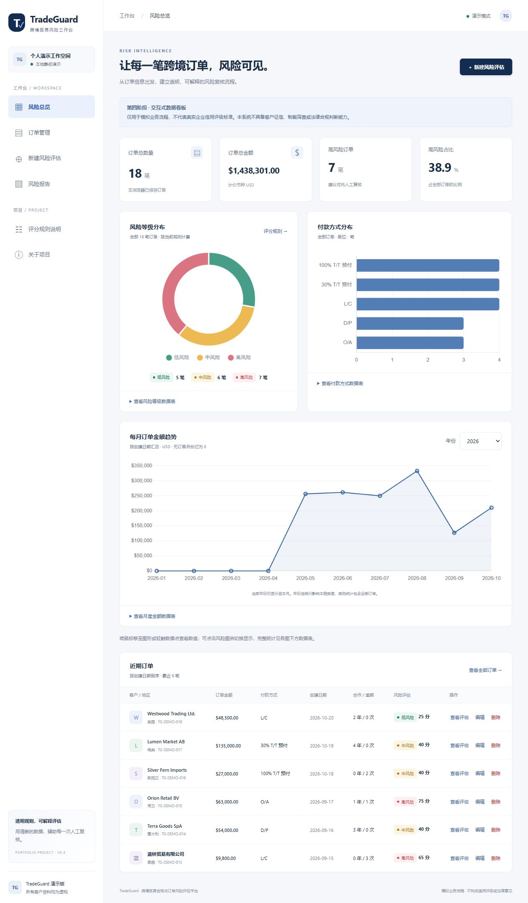

# TradeGuard｜跨境贸易合规与订单风险评估平台

面向合规、外贸、风控与运营实习申请的个人作品集：将客户与订单信息整理为可解释的风险评分、可视化看板和人工复核报告，展示利用 AI 辅助工具实现业务流程的实践。

**状态：本地功能已实现，部署材料已准备；尚未发布到 GitHub Pages。报告打印入口已实现，实际 PDF 成品尚未验收。**

全部客户与订单均为虚构。系统仅模拟业务流程，不代表真实企业信用评级标准，不具备客户征信、制裁筛查或法律合规判断能力。



## 项目背景与业务流程

跨境订单的付款条件、金额、合作历史和逾期记录，适合用作模拟风险复核的切入点。本项目关注如何把分散信息转化为可核对、可解释的工作台，而不是自动替代业务或法律决策。

**录入虚构客户与订单 → 验证并本地保存 → 自动规则评分 → 查看明细与风险因素 → 人工复核 → 导出订单或打印报告。**

首次访问自动生成 18 条演示订单，HR 无需注册即可体验。修改后保留用户数据；删除所有订单不会自动重新填充。

## 功能

| 模块 | 已实现能力 |
| --- | --- |
| 风险总览 | 订单总数、总金额、高风险数量与占比；风险等级环形图、付款方式柱状图、月度金额趋势 |
| 订单管理 | 新增、编辑、确认删除；按客户、地区、编号或备注搜索；付款方式和地区组合筛选 |
| 风险评估 | 四项透明评分、最高分封顶、风险等级、风险因素及针对性人工复核建议 |
| 评估详情 | 客户与订单信息、评分依据、规则版本、生成日期；打印与浏览器保存 PDF 入口 |
| 数据管理 | localStorage 保存、CSV 模板、导入预览与确认、导出全部订单、确认恢复演示数据 |
| 易用性 | 简体中文、响应式布局、键盘焦点、手机导航、长内容换行、图表备用数据表 |

## 直接体验

下载完整项目后，双击根目录 `index.html` 即可打开。无需安装依赖、配置密钥或启动后端；图表库已包含在项目中。

建议先在“订单管理”点击一笔订单的“查看评估”，再编辑其付款方式或逾期次数，观察评分及首页统计变化。“恢复演示数据”会替换全部当前订单，操作前可先导出备份。

本地文件模式的存储行为取决于浏览器；最终展示建议使用稳定的 GitHub Pages 地址。部署后访问者各自使用自己的浏览器存储，不会修改作者或其他访问者的数据。

## 技术方案

- 原生 HTML、CSS、JavaScript，无框架、无构建步骤、无后端和数据库。
- localStorage 保存订单；拒绝无效输入，保存失败不更新内存列表，检测常见旧标签页覆盖。
- Chart.js 4.5.1 随项目本地分发，不依赖运行时 CDN、付费 API 或真实 AI 模型。
- 相对资源路径与 hash 导航，适合 GitHub Pages 项目子路径；根目录含 `.nojekyll`。
- CSV 采用 UTF-8 BOM，支持逗号、双引号与多行文本；文本公式符号导出时增加单引号保护。

## 模拟评分规则

分数越高表示本模拟规则下的复核优先级越高。所有规则集中在 `assets/risk.js`，计算、说明页面与评分明细共用同一配置。

| 维度 | 条件 | 分值 |
| --- | --- | --- |
| 订单金额 | ≤50,000 / >50,000 且 ≤100,000 / >100,000 美元 | 5 / 15 / 25 |
| 付款方式 | 100% T/T 预付 / 30% T/T 预付 / L/C / D/P / O/A | 0 / 15 / 10 / 25 / 35 |
| 合作年限 | 首次合作（0 年）/ 1—2 年 / ≥3 年 | 20 / 10 / 0 |
| 历史逾期 | 0 次 / 1—2 次 / ≥3 次 | 0 / 15 / 30 |

四项相加后最高限制为 **100 分**：0—29 为低风险，30—59 为中风险，60—100 为高风险。原始合计最高可达 110 分，详情会展示封顶过程。国家或地区、客户名称、日期与备注不参与评分。

评分从当前订单即时计算，编辑后不沿用缓存分数；报告是当前数据的展示，不是历史快照。即使低风险，也需要人工核实信息与合同。

## 数据、CSV 与打印

数据只保存在当前浏览器及访问地址下。清除网站数据会移除订单，更换浏览器、设备、域名或端口不会同步。旧标签页检测不提供数据库事务保障，发现冲突后需记录输入并刷新。

CSV 导出包含全部订单的九列原始信息，不受筛选影响；评分在读取时重新计算。导入只追加，重复编号整批拒绝，编号留空则自动生成；每次最多 2 MB / 2000 笔，总订单上限 10000 笔。上限不是性能承诺，未完成该规模的性能验收。

日期使用 `YYYY-MM-DD`，不得晚于今天；金额为非负普通十进制数字，最多两位小数；年限与次数为非负整数。完整格式和操作说明见 [使用指南](docs/USER_GUIDE.md)。

报告使用浏览器打印，建议选择 A4 和“另存为 PDF”。已编写专用打印样式；内置浏览器调用系统打印时超时，**实际 PDF 文件、分页与长备注打印效果尚未验证**。

## 测试与验证状态

安装 Node.js 的开发者可在项目根目录运行，网站使用者无需安装：

```text
node --test tests/orders.test.cjs tests/risk.test.cjs tests/dashboard.test.cjs tests/csv.test.cjs
node scripts/check-release.cjs
```

20 组功能自动化测试通过，覆盖评分边界、135 种规则组合、订单增删改查与刷新加载、图表汇总、异常 CSV、存储失败、旧标签页冲突及输入转义。自动化页面测试使用模拟 DOM、存储和图表实例。

真实内置浏览器已检查本地 `/tradeguard/` 子路径、实际图表绘制、订单新增编辑删除、刷新保留、CSV 下载及导入、320px / 390px / 768px 布局与双标签页写入冲突。完整记录见 [验收记录](docs/QA.md)。未验证所有设备、Safari、Android 浏览器、真实 GitHub Pages 地址或 PDF 成品。

## GitHub Pages 部署

本项目无需构建。推荐发布源为 `main` 分支的仓库根目录；`index.html` 和 `assets/` 必须保持同级。当前没有关联远程仓库，未提交、上传或发布，文档中没有虚构线上演示链接。

[部署指南](docs/DEPLOYMENT.md)记录了准备情况、GitHub Pages 设置和发布后验收。该指南是备用参考；实际协作时逐步完成，不需要一次执行所有步骤。

## 项目结构

```text
index.html                 入口与应用外壳
.nojekyll                  GitHub Pages 静态发布标记
assets/
  styles.css               界面、响应式及打印样式
  orders.js                订单验证、演示数据和持久化
  risk.js                  集中风险规则与计算
  app.js                   公共内容
  order-ui.js              路由、订单表单、列表和事件
  risk-ui.js               评分说明与报告
  dashboard.js             看板汇总与 Chart.js 生命周期
  csv.js / data-ui.js       CSV 编解码与数据管理交互
  vendor/                  Chart.js 与 MIT 许可证
tests/                     功能回归测试与虚构异常 CSV
scripts/check-release.cjs   静态资源和文档链接检查
docs/                      使用、部署、验收记录与真实截图
```

## Codex 辅助与项目边界

本项目由用户提出业务需求和作品集目标，OpenAI Codex 辅助完成文件结构、界面设计、JavaScript 实现、规则配置、调试、自动化测试及文档。求职展示时应如实说明 AI 的参与，不应声称全部代码由本人独立手写，或声称具备尚未验证的上线成果。

项目可用于解释需求拆解、信息结构、透明规则设计、异常处理和验收思路；技术实现与业务结论仍需使用者理解和核对。

规则没有经过真实企业样本校准，未覆盖货物、合同、汇率、运输、司法管辖等因素，不可用于实际授信或法律决策。不接入信用数据库、制裁名单或真实 AI 推理服务。请勿输入或上传真实客户资料。

第三方 Chart.js 许可证保留在 [Chart.js-LICENSE.md](assets/vendor/Chart.js-LICENSE.md)。
